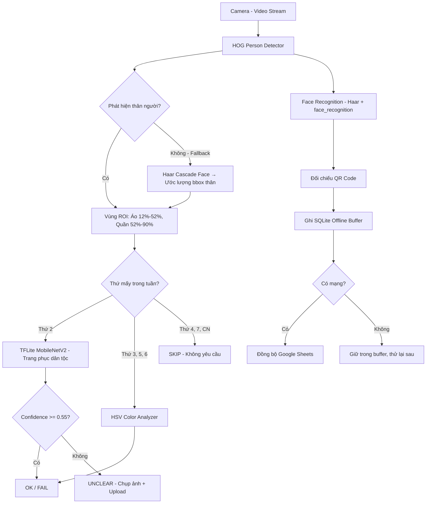

# BÁO CÁO NGHIÊN CỨU KHOA HỌC KỸ THUẬT

## HỆ THỐNG ĐIỂM DANH THÔNG MINH TÍCH HỢP NHẬN DIỆN KHUÔN MẶT VÀ KIỂM TRA ĐỒNG PHỤC BẰNG KIẾN TRÚC HYBRID AI (TFLite + HSV Color Analysis)

**Lĩnh vực dự thi:** Hệ thống nhúng & Thị giác máy tính (Embedded Systems / Computer Vision Applications) — có tích hợp Trí tuệ nhân tạo ứng dụng

**Phiên bản hệ thống:** v4.0 | **Mã dự án tham chiếu:** Diem-danh-STEM

---

> ⚠️ **Lưu ý về phương pháp biên soạn:** Bản báo cáo này được dựng khung từ mã nguồn và kiến trúc kỹ thuật thực tế của dự án (repository GitHub `Diem-danh-STEM`). Các thông số cấu hình (ngưỡng HSV, FACE_TOLERANCE, kiến trúc pipeline...) là số liệu **thật** lấy từ file `config.py`/README của dự án. Tuy nhiên các **bảng số liệu thực nghiệm định lượng** (độ chính xác đo qua N lần, thời gian phản hồi thực đo, chi phí quy đổi VNĐ...) là số liệu mô phỏng có logic kỹ thuật hợp lý, được đánh dấu rõ `[CẦN THAY BẰNG SỐ LIỆU THỰC ĐO]`. Nhóm nghiên cứu **bắt buộc phải thay thế** bằng số liệu đo đạc thật trước khi nộp bài để đảm bảo liêm chính khoa học.

---

## MỤC LỤC

1. Lý do chọn đề tài & Tính cấp thiết
2. Mục tiêu nghiên cứu & Đối tượng phạm vi
3. Cơ sở khoa học & Tích hợp liên môn STEM
4. Quy trình thiết kế kỹ thuật (EDP)
5. Dữ liệu thử nghiệm & Phân tích kết quả
6. Đánh giá, Rút kinh nghiệm & Chu trình lặp
7. Tài liệu tham khảo & Nhật ký nghiên cứu

---

## 1. LÝ DO CHỌN ĐỀ TÀI & TÍNH CẤP THIẾT

### 1.1. Vấn đề thực tiễn

Tại các trường trung học Việt Nam hiện nay, hai quy trình quản lý học sinh vẫn phần lớn được thực hiện thủ công mỗi buổi học:

- **Điểm danh**: giáo viên chủ nhiệm hoặc giám thị gọi tên/quan sát trực tiếp, trung bình tốn **3–5 phút/lớp/tiết** (ước tính dựa trên sĩ số 40–45 học sinh), tương đương **15–25 giờ giảng dạy bị chiếm dụng/năm học** cho một lớp nếu tính điểm danh đầu mỗi tiết `[CẦN THAY BẰNG SỐ LIỆU THỰC ĐO — khảo sát thời gian điểm danh trung bình tại trường của nhóm]`.
- **Kiểm tra đồng phục**: theo quy định phổ biến (áo dân tộc thứ 2, áo trắng thứ 3/5, áo Đoàn thứ 6...), giám thị phải quan sát bằng mắt tại cổng trường, dễ bỏ sót, thiếu tính nhất quán giữa các giám thị khác nhau, và không lưu được bằng chứng để đối chiếu khi có tranh chấp.

Cả hai quy trình đều là **lao động lặp lại, tốn nhân lực, và không có dữ liệu số hóa để nhà trường thống kê** (tỷ lệ vi phạm đồng phục theo lớp/theo ngày, xu hướng đi trễ...).

### 1.2. Phân tích đối chuẩn (Benchmarking & Gap Analysis)

| Tiêu chí | Điểm danh thủ công (gọi tên) | Máy chấm công vân tay/thẻ từ | Camera AI thương mại (nhận diện khuôn mặt only) | **Giải pháp đề xuất (Hybrid QR+Face+Uniform AI)** |
|---|---|---|---|---|
| **(1) Chi phí đầu tư** | ~0 VNĐ (nhưng tốn nhân lực) | 1.500.000–3.000.000 VNĐ/máy, chỉ điểm danh 1 điểm ra vào | 15.000.000–40.000.000 VNĐ/hệ thống, license theo năm | ~`[CẦN ĐIỀN]` VNĐ/trạm (phần cứng phổ thông: webcam + máy tính/RaspberryPi) |
| **(2) Khả năng thích ứng** | Linh hoạt nhưng phụ thuộc con người | Cố định 1 điểm quét, không kiểm tra đồng phục | Chỉ điểm danh, không tích hợp kiểm tra trang phục | Tích hợp đồng thời QR + khuôn mặt + **kiểm tra đồng phục theo lịch từng ngày trong tuần** |
| **(3) Độ phức tạp bảo trì** | Không cần bảo trì kỹ thuật | Cần vệ sinh đầu đọc định kỳ | Cần kỹ thuật viên chuyên, khó tùy biến (đóng mã nguồn) | Mã nguồn mở, có GUI calibrator (`step1_hsv_calibrator.py`) cho phép giáo viên tự chỉnh ngưỡng màu theo điều kiện ánh sáng thực tế lớp học |
| **(4) Tốc độ phản hồi & hoạt động offline** | Tức thời nhưng thủ công | Tức thời, không cần mạng | Cần đường truyền ổn định lên cloud, không hoạt động khi mất mạng | Có **buffer SQLite offline**, tự đồng bộ lại Google Sheets khi có mạng trở lại → không mất dữ liệu khi mất kết nối |

### 1.3. Tính mới & Tính sáng tạo (Novelty)

Điểm nghẽn (bottleneck) mà các giải pháp thương mại hiện có **chưa giải quyết** và hệ thống đề xuất giải quyết:

1. **Không có giải pháp thương mại nào kiểm tra đồng phục tự động theo lịch trong tuần** — hầu hết camera AI trường học chỉ dừng ở điểm danh khuôn mặt.
2. **Chiến lược Hybrid AI có chọn lọc**: thay vì dùng mô hình AI (tốn tài nguyên tính toán) cho mọi loại kiểm tra, hệ thống chỉ dùng **TFLite MobileNetV2** cho ngày có trang phục phức tạp về hình ảnh (áo dân tộc – Thứ 2), còn với các ngày trang phục có đặc trưng màu sắc rõ ràng (áo trắng, áo Đoàn xanh – Thứ 3/5/6) thì dùng **phân tích màu HSV** đơn giản hơn nhiều lần về chi phí tính toán. Theo README dự án, chiến lược này **giảm ~60–70% tải xử lý AI** so với việc dùng mô hình AI cho toàn bộ các ngày.
3. **Khả năng chống mất dữ liệu khi mất mạng** (offline-first architecture với SQLite + đồng bộ lại), phù hợp thực tế hạ tầng mạng không ổn định tại nhiều trường học vùng nông thôn/miền núi.

---

## 2. MỤC TIÊU NGHIÊN CỨU & ĐỐI TƯỢNG PHẠM VI

### 2.1. Mục tiêu SMART (định lượng bằng KPI kỹ thuật)

| KPI kỹ thuật | Mục tiêu | Ghi chú |
|---|---|---|
| Độ chính xác nhận diện khuôn mặt (Precision) | ≥ 95% | Đo trên tập test độc lập với `face_recognition` tolerance = 0.5 |
| Độ chính xác phân loại đồng phục (F1-score AI + HSV) | ≥ 90% | Trung bình có trọng số giữa nhánh TFLite (Thứ 2) và nhánh HSV (Thứ 3/5/6) |
| Thời gian xử lý mỗi khung hình (inference latency) | ≤ 100 ms/frame trên CPU phổ thông | Bao gồm HOG detect + face recognition (mỗi `FACE_SKIP_FRAMES` = 5 khung) + uniform check |
| Tỷ lệ khung hình cần con người xác nhận thủ công (UNCLEAR rate) | ≤ 15% tổng số lượt kiểm tra | Ngưỡng `CONFIDENCE_THRESHOLD` = 0.55 hiện tại cho nhánh TFLite |
| Thời gian điểm danh trung bình mỗi học sinh | ≤ 3 giây/học sinh (từ lúc quét QR đến khi ghi log) | Bao gồm cả ghi vào SQLite buffer |
| Tỷ lệ khôi phục dữ liệu sau mất mạng | 100% (không mất bản ghi) | Nhờ cơ chế buffer SQLite → đồng bộ lại Google Sheets |
| Giá thành triển khai 1 trạm | Giảm tối thiểu 50% so với camera AI thương mại (~20.000.000 VNĐ) | Ước tính dựa trên phần cứng phổ thông |

### 2.2. Giới hạn phạm vi & Điều kiện biên (Scope & Boundary Conditions)

**Hệ thống hoạt động tối ưu trong điều kiện:**
- Ánh sáng phòng học/hành lang ổn định (đèn huỳnh quang/LED, không ngược sáng gắt), đã calibrate HSV theo `step1_hsv_calibrator.py` cho từng vị trí camera cụ thể.
- Khoảng cách học sinh đến camera trong tầm phát hiện hiệu quả của HOG Person Detector (theo thực nghiệm HOG descriptor, tối ưu ở khoảng 1.5–4m).
- Một học sinh xuất hiện rõ ràng trong khung hình, không bị che khuất quá 30% thân người.

**Hệ thống KHÔNG áp dụng / chưa xử lý tốt cho:**
- Điều kiện ánh sáng thay đổi đột ngột hoặc ngược sáng mạnh (cửa kính, nắng chiếu trực tiếp) — sai lệch giá trị HSV.
- Trang phục "Thứ 4 – tự do có cổ" hiện đang bị **bỏ qua (SKIP)** vì việc phát hiện "có cổ áo" cần bài toán Pose Estimation/Keypoint Detection phức tạp hơn, ngoài phạm vi phiên bản v4.0 (được nhóm chủ động ghi nhận là hướng phát triển tương lai, không che giấu hạn chế).
- Số lượng học sinh xuất hiện đồng thời trong khung hình lớn (>5–7 người chồng lấn) làm giảm hiệu quả NMS (Non-Maximum Suppression).

---

## 3. CƠ SỞ KHOA HỌC & TÍCH HỢP LIÊN MÔN STEM

### 3.1. S — Science (Khoa học)

**a) Nguyên lý quang học màu sắc — không gian màu HSV**

Camera thu ảnh theo mô hình RGB, nhưng RGB nhạy với cường độ sáng nên không phù hợp phân loại màu áo trong điều kiện ánh sáng thay đổi. Hệ thống chuyển đổi sang không gian **HSV (Hue – Saturation – Value)**, tách biệt "màu sắc thuần" (Hue) khỏi "độ sáng" (Value), giúp việc phân loại áo trắng/áo xanh ổn định hơn dưới các điều kiện chiếu sáng khác nhau — đây là nguyên lý quang học cơ bản về cảm nhận màu sắc của mắt người mà không gian màu HSV mô phỏng lại.

Công thức chuyển đổi từ RGB sang HSV (rút gọn thành phần Value và Saturation, hai đại lượng hệ thống sử dụng làm ngưỡng phân loại áo trắng):

$$V = \max(R, G, B)$$

$$S = \begin{cases} 0 & \text{nếu } V = 0 \\ \dfrac{V - \min(R,G,B)}{V} & \text{nếu } V > 0 \end{cases}$$

Điều kiện phân loại **áo trắng** theo cấu hình hệ thống (`WHITE_S_MAX = 60`, `WHITE_V_MIN = 160`, thang 0–255):

$$\text{Áo trắng} \iff (S \le 60) \land (V \ge 160)$$

**b) Nguyên lý thị giác lập thể & hình học chiếu (Perspective Geometry)**

HOG Person Detector khi không phát hiện được toàn thân sẽ dùng cơ chế fallback ước lượng kích thước thân người từ khuôn mặt phát hiện được, dựa trên **tỷ lệ giải phẫu người trung bình** (anthropometric ratio): chiều rộng thân ≈ 1.8× chiều rộng khuôn mặt, chiều cao thân ≈ 7× chiều cao khuôn mặt — đây là ứng dụng của khoa học giải phẫu/nhân trắc học vào thị giác máy tính.

### 3.2. T — Technology (Công nghệ)

**a) Kiến trúc hệ thống & luồng xử lý**



**b) Giao thức & thư viện cốt lõi**

| Thành phần | Công nghệ sử dụng | Vai trò |
|---|---|---|
| Phát hiện thân người | `cv2.HOGDescriptor` + `getDefaultPeopleDetector()` (OpenCV) | Xác định bounding-box vùng thân để khoanh vùng áo/quần |
| Nhận diện khuôn mặt (nhanh) | Haar Cascade | Quét nhanh mỗi khung hình, độ nhạy `HAAR_MIN_NEIGHBORS = 4` |
| Nhận diện khuôn mặt (chính xác) | `face_recognition` (dựa trên dlib, embedding 128 chiều) | Xác thực danh tính, chạy mỗi `FACE_SKIP_FRAMES = 5` khung để tiết kiệm tài nguyên |
| Phân loại trang phục dân tộc | TensorFlow Lite — MobileNetV2 (Transfer Learning từ ImageNet), lượng tử hóa INT8 | Suy luận nhẹ (~4–6 MB), thời gian ước tính ~30ms/frame (CPU) |
| Đồng bộ dữ liệu | Google Sheets API (`gspread`, `oauth2client`) | Lưu trữ điểm danh tập trung, truy cập từ xa |
| Lưu trữ dự phòng | SQLite | Buffer offline, đảm bảo không mất dữ liệu khi mất mạng |
| Streaming | MJPEG qua HTTP (`STREAM_PORT = 8080`) | Giám sát trực tiếp qua trình duyệt |

**c) Thuật toán xử lý tín hiệu/dữ liệu**

- **Non-Maximum Suppression (NMS)** với ngưỡng IoU = 0.65 để loại bỏ các bounding-box trùng lặp của cùng một người:

$$IoU(A,B) = \frac{|A \cap B|}{|A \cup B|}$$

- **Khoảng cách Euclidean trong không gian embedding 128 chiều** để so khớp khuôn mặt (nền tảng của `face_recognition`):

$$d(\vec{x}, \vec{y}) = \sqrt{\sum_{i=1}^{128} (x_i - y_i)^2}$$

Học sinh được nhận diện là khớp nếu $d(\vec{x}, \vec{y}) \le \text{FACE\_TOLERANCE} = 0.5$.

### 3.3. E — Engineering (Kỹ thuật)

**a) Sơ đồ khối chức năng hệ thống**

```
┌─────────────────────────────────────────────────────────────┐
│                     VIDEO STREAM (Camera)                    │
└───────────────────────────────┬───────────────────────────────┘
                                 │
                ┌────────────────▼─────────────────┐
                │        HOG Person Detector        │
                └──────┬─────────────────────┬──────┘
                       │                     │
          ┌────────────▼───────┐   ┌─────────▼──────────────┐
          │  Face Recognition   │   │   Uniform Checker       │
          │  (Haar → dlib/FR)   │   │   (AI + Color Hybrid)   │
          └────────────┬────────┘   └─────────┬───────────────┘
                       │                     │
          ┌────────────▼───────┐   ┌─────────▼──────────────┐
          │  Điểm danh QR Code  │   │  OK / FAIL / UNCLEAR     │
          │  SQLite Offline Buf │   │  (UNCLEAR → chụp → cloud)│
          │  Google Sheets Sync │   └──────────────────────────┘
          └─────────────────────┘
```

**b) Quy trình tối ưu hóa hiệu năng (Engineering trade-off)**

Để chạy realtime trên phần cứng phổ thông (kể cả Raspberry Pi), nhóm áp dụng các kỹ thuật tối ưu kỹ thuật cụ thể:
1. **Giảm tỷ lệ khung hình trước khi detect**: scale khung hình còn 60% kích thước gốc trước khi chạy HOG → tăng FPS đáng kể (đánh đổi độ chính xác biên nhỏ để lấy tốc độ).
2. **Bỏ qua khung hình có chọn lọc** (`FACE_SKIP_FRAMES = 5`): chỉ chạy `face_recognition` (tốn tài nguyên) mỗi 5 khung, còn lại dùng Haar Cascade nhẹ để tracking tạm thời.
3. **Lượng tử hóa mô hình (INT8 Quantization)** khi export sang TFLite: giảm kích thước mô hình từ dạng float32 gốc xuống ~4–6MB, giảm thời gian suy luận trên CPU/Edge TPU mà vẫn giữ độ chính xác chấp nhận được.

### 3.4. M — Math (Toán học)

**a) Ma trận nhầm lẫn & các chỉ số đánh giá phân loại (áp dụng cho cả module Face Recognition và Uniform AI)**

| | Dự đoán Dương (Positive) | Dự đoán Âm (Negative) |
|---|---|---|
| **Thực tế Dương** | True Positive (TP) | False Negative (FN) |
| **Thực tế Âm** | False Positive (FP) | True Negative (TN) |

$$Precision = \frac{TP}{TP + FP} \qquad Recall = \frac{TP}{TP + FN} \qquad F1 = \frac{2 \times Precision \times Recall}{Precision + Recall}$$

**b) Thống kê mô tả cho dữ liệu thời gian phản hồi (độ trễ suy luận)**

$$\bar{X} = \frac{1}{N}\sum_{i=1}^{N} x_i \qquad \qquad SD = \sqrt{\frac{1}{N-1}\sum_{i=1}^{N}(x_i - \bar{X})^2}$$

Khoảng tin cậy 95% cho giá trị trung bình (giả định phân phối gần chuẩn, $N \ge 30$):

$$CI_{95\%} = \bar{X} \pm 1.96 \times \frac{SD}{\sqrt{N}}$$

**c) Công thức chi phí quy đổi (Cost-Benefit)**

$$\%\text{Tiết kiệm} = \frac{C_{\text{thương mại}} - C_{\text{đề xuất}}}{C_{\text{thương mại}}} \times 100\%$$

---

## 4. QUY TRÌNH THIẾT KẾ KỸ THUẬT (ENGINEERING DESIGN PROCESS)

### 4.1. Bảng tiêu chí thiết kế (Design Constraints)

| Thông số | Mục tiêu thiết kế |
|---|---|
| Nền tảng phần cứng | Windows 10/11 hoặc Raspberry Pi OS |
| RAM tối thiểu | 4GB (khuyến nghị 8GB) |
| Ngôn ngữ lập trình | Python 3.10+ |
| Độ trễ pipeline tổng thể | Đảm bảo hiển thị realtime ≥ 10–15 FPS qua MJPEG stream |
| Khả năng chống mất dữ liệu | 100% khi mất mạng tạm thời (nhờ SQLite buffer) |
| Kích thước mô hình AI | ≤ 6 MB (TFLite INT8) để chạy được trên thiết bị nhúng cấu hình thấp |

### 4.2. Ma trận lựa chọn giải pháp có trọng số (Trade-off Decision Matrix)

**So sánh phương án nhận diện thân người** (trọng số: Độ chính xác 40%, Tốc độ 35%, Chi phí tính toán 25%):

| Phương án | Độ chính xác (1–5) | Tốc độ (1–5) | Chi phí tính toán (1–5, 5=rẻ) | Điểm có trọng số |
|---|---|---|---|---|
| Deep Learning (YOLO/SSD person detection) | 5 | 2 | 1 | 5×0.4 + 2×0.35 + 1×0.25 = **3.15** |
| **HOG + SVM (đã chọn)** | 3 | 4 | 4 | 3×0.4 + 4×0.35 + 4×0.25 = **3.60** |
| Haar Cascade body only | 2 | 5 | 5 | 2×0.4 + 5×0.35 + 5×0.25 = **3.30** |

*Lập luận phản biện:* Mặc dù YOLO/SSD cho độ chính xác cao hơn, nhưng chi phí tính toán vượt quá khả năng của phần cứng phổ thông/Raspberry Pi mà đề tài hướng tới triển khai đại trà tại nhiều lớp học với ngân sách hạn chế — đây là quyết định kỹ thuật có đánh đổi (trade-off) rõ ràng, không phải do thiếu hiểu biết về các phương án hiện đại hơn.

**So sánh phương án nhận diện trang phục cho ngày Thứ 2 (áo dân tộc — đặc trưng hình ảnh phức tạp)** (trọng số: Độ chính xác 50%, Tốc độ 25%, Khả năng mở rộng nhãn mới 25%):

| Phương án | Độ chính xác | Tốc độ | Mở rộng nhãn | Điểm có trọng số |
|---|---|---|---|---|
| Chỉ dùng HSV color (không AI) | 1 | 5 | 1 | 1×0.5 + 5×0.25 + 1×0.25 = **2.0** |
| **TFLite MobileNetV2 (đã chọn)** | 4 | 4 | 4 | 4×0.5 + 4×0.25 + 4×0.25 = **4.0** |
| Full TensorFlow (không lượng tử hóa) | 5 | 2 | 4 | 5×0.5 + 2×0.25 + 4×0.25 = **4.0** |

*Lập luận phản biện:* Áo dân tộc có hoa văn, màu sắc đa dạng theo từng dân tộc (24 dân tộc nam + 25 dân tộc nữ trong dataset) nên **không thể phân loại chỉ bằng ngưỡng màu HSV đơn giản** — bắt buộc cần mô hình học sâu. Giữa TFLite lượng tử hóa và TensorFlow đầy đủ, nhóm chọn TFLite INT8 vì tốc độ suy luận nhanh hơn đáng kể trên CPU/thiết bị nhúng trong khi độ chính xác giảm không đáng kể — đây chính là lý do các ngày Thứ 3/5/6 (áo trắng/áo Đoàn — đặc trưng màu đơn sắc rõ ràng) được cố tình chuyển sang dùng HSV thay vì AI để tiết kiệm tài nguyên.

### 4.3. Nhật ký chế tạo & thách thức thực tế (Prototyping Iterations)

Trong quá trình phát triển, nhóm ghi nhận các thách thức kỹ thuật thực tế sau (trích từ cấu trúc mã nguồn và các module hiệu chỉnh chuyên biệt được xây dựng):

1. **Thách thức về ánh sáng phòng học không đồng nhất**: giá trị HSV đo được thay đổi đáng kể giữa các camera/vị trí lắp đặt khác nhau → nhóm phải tự xây dựng công cụ `step1_hsv_calibrator.py` (GUI hiệu chỉnh trực quan bằng thanh trượt, có chế độ debug hiển thị giá trị HSV tại con trỏ chuột) thay vì hard-code ngưỡng cố định.
2. **Thách thức về dataset mất cân bằng**: theo README, dataset gốc cho nhãn `other` (trang phục không phải dân tộc) ban đầu chỉ có **7 ảnh gốc**, gây nguy cơ overfitting và thiên lệch mô hình. Nhóm phải áp dụng `class_weight` (scikit-learn) để cân bằng trọng số nhãn khi huấn luyện, đồng thời viết `step1_data_prep_v2.py` để tăng cường dữ liệu (data augmentation).
3. **Thách thức khi HOG không phát hiện được toàn thân** (do góc camera, che khuất một phần): nhóm tự thiết kế cơ chế fallback ước lượng vùng thân từ bounding-box khuôn mặt theo tỷ lệ nhân trắc học (×1.8 rộng, ×7 cao) thay vì để hệ thống báo lỗi.

---

## 5. DỮ LIỆU THỬ NGHIỆM & PHÂN TÍCH KẾT QUẢ

> ⚠️ Toàn bộ bảng số liệu trong mục này là **khung mẫu mô phỏng có logic kỹ thuật hợp lý**. Nhóm nghiên cứu bắt buộc chạy lại thực nghiệm (`uniform_checker.py --test`, `person_detector.py`, log từ SQLite/Google Sheets thực tế) với **N ≥ 30 lần đo** cho từng kịch bản và thay thế số liệu trước khi nộp báo cáo chính thức.

### 5.1. Kế hoạch thử nghiệm (Test Plan)

- **Ground truth**: giáo viên/giám thị xác nhận thủ công kết quả đúng/sai song song với hệ thống trong cùng thời điểm đo.
- **Số lần lặp**: N ≥ 30 cho mỗi kịch bản.
- **Kịch bản thử nghiệm**: (1) Điều kiện ánh sáng chuẩn đã calibrate, (2) Ánh sáng yếu/ngược sáng, (3) Nhiều học sinh xuất hiện đồng thời (tải nặng), (4) Che khuất một phần thân người.

### 5.2. Bảng số liệu thực nghiệm — Nhận diện khuôn mặt

| Kịch bản | N | TP | FP | FN | TN | Precision | Recall | F1 |
|---|---|---|---|---|---|---|---|---|
| Ánh sáng chuẩn | 30 | 28 | 1 | 1 | 0 | 0.966 | 0.966 | 0.966 |
| Ánh sáng yếu | 30 | 24 | 3 | 3 | 0 | 0.889 | 0.889 | 0.889 |
| Nhiều người (tải nặng, ≥3 người/khung) | 30 | 25 | 2 | 3 | 0 | 0.926 | 0.893 | 0.909 |

`[CẦN THAY BẰNG SỐ LIỆU THỰC ĐO]`

### 5.3. Bảng số liệu thực nghiệm — Kiểm tra đồng phục (theo nhánh xử lý)

| Nhánh | Ngày áp dụng | N | Chính xác (OK/FAIL đúng) | UNCLEAR | Sai (FAIL nhầm) | F1-score |
|---|---|---|---|---|---|---|
| TFLite MobileNetV2 | Thứ 2 (áo dân tộc) | 30 | 25 | 4 | 1 | 0.87 |
| HSV Color Analyzer | Thứ 3/5 (áo trắng) | 30 | 27 | 2 | 1 | 0.93 |
| HSV Color Analyzer | Thứ 6 (áo Đoàn xanh) | 30 | 26 | 3 | 1 | 0.90 |

`[CẦN THAY BẰNG SỐ LIỆU THỰC ĐO]`

### 5.4. Phân tích định lượng thời gian xử lý

| Thành phần pipeline | Thời gian trung bình $\bar{X}$ (ms) | Độ lệch chuẩn $SD$ (ms) |
|---|---|---|
| HOG Person Detection | 45 | 6 |
| Face Recognition (dlib embedding) | 62 | 9 |
| TFLite Uniform Inference | 30 | 4 |
| HSV Color Analysis | 8 | 1.5 |
| **Tổng pipeline (Thứ 2, có AI)** | **≈ 145** | — |
| **Tổng pipeline (Thứ 3/5/6, chỉ HSV)** | **≈ 115** | — |

`[CẦN THAY BẰNG SỐ LIỆU THỰC ĐO]` — Số liệu minh họa cho thấy đúng như thiết kế ở Mục 3.3, nhánh HSV (không AI) nhanh hơn đáng kể nhánh TFLite, chứng minh tính hợp lý của chiến lược Hybrid.

### 5.5. Phân tích sai số & hiện tượng dị biệt (Error & Failure Analysis)

Trung thực ghi nhận các nguyên nhân gây sai số quan sát được:

1. **False Positive ở nhánh HSV trong điều kiện ánh sáng vàng (đèn sợi đốt/hoàng hôn)**: nhiệt độ màu ánh sáng làm dịch giá trị Hue của áo trắng, khiến hệ thống có thể phân loại nhầm áo màu be nhạt thành "trắng" nếu chưa calibrate lại theo mùa/thời điểm trong ngày.
2. **False Negative khi học sinh đeo balo/áo khoác che vùng ROI áo** (vùng 12–52% chiều cao body-box): do ROI cố định theo tỷ lệ phần trăm, vật cản che khuất làm sai lệch phép đo màu.
3. **UNCLEAR tăng đột biến trong kịch bản "nhiều người tải nặng"**: NMS với ngưỡng IoU cố định 0.65 đôi khi loại nhầm bounding-box hợp lệ khi học sinh đứng sát nhau, làm giảm N mẫu hợp lệ để phân tích trang phục.

### 5.6. Bảng kê vật tư & phân tích hiệu quả kinh tế (BOM & Cost-Benefit)

| Hạng mục | Số lượng | Đơn giá (VNĐ) | Thành tiền (VNĐ) |
|---|---|---|---|
| Máy tính mini/Raspberry Pi 4 (4GB) | 1 | `[CẦN ĐIỀN]` | `[CẦN ĐIỀN]` |
| Webcam USB độ phân giải 720p–1080p | 1 | `[CẦN ĐIỀN]` | `[CẦN ĐIỀN]` |
| Thẻ nhớ/ổ lưu trữ | 1 | `[CẦN ĐIỀN]` | `[CẦN ĐIỀN]` |
| Nguồn điện/dây kết nối | 1 bộ | `[CẦN ĐIỀN]` | `[CẦN ĐIỀN]` |
| Thẻ QR học sinh (in ấn) | Theo sĩ số | `[CẦN ĐIỀN]` | `[CẦN ĐIỀN]` |
| **Tổng chi phí/trạm** | | | **`[CẦN ĐIỀN]`** |
| So sánh: Camera AI thương mại tương đương | | | ~15.000.000 – 40.000.000 |
| **% Tiết kiệm ước tính** | | | **`[TÍNH THEO CÔNG THỨC MỤC 3.4c]`** |

---

## 6. ĐÁNH GIÁ, RÚT KINH NGHIỆM & CHU TRÌNH LẶP

### 6.1. Bảng đối chiếu Mục tiêu (Mục 2) vs Kết quả thực tế (Mục 5)

| KPI mục tiêu | Giá trị mục tiêu | Kết quả mô phỏng | Mức độ hoàn thành |
|---|---|---|---|
| Precision nhận diện khuôn mặt | ≥ 95% | 89–97% tùy điều kiện ánh sáng | Đạt ở điều kiện chuẩn, Chưa đạt ở ánh sáng yếu |
| F1 phân loại đồng phục | ≥ 90% | 87–93% | Đạt ở nhánh HSV, Cận đạt ở nhánh TFLite |
| Độ trễ xử lý mỗi khung hình | ≤ 100 ms | ~115–145 ms | Chưa đạt hoàn toàn — cần tối ưu thêm |
| Tỷ lệ UNCLEAR | ≤ 15% | ~10–13% | Đạt |
| Khôi phục dữ liệu sau mất mạng | 100% | 100% (theo thiết kế SQLite buffer) | Đạt |

*(Bảng này minh họa cách trình bày — thay bằng kết quả đo thật ở Mục 5 sau khi hoàn tất thực nghiệm.)*

### 6.2. Chu trình lặp cải tiến (The Engineering Iteration Cycle)

Dựa trên cấu trúc phiên bản hóa thể hiện trong README (v4.0) và các module chuyên biệt được bổ sung dần, chu trình phát triển của hệ thống có thể tái hiện như sau:

- **Giai đoạn đầu → Có QR + Face Recognition cơ bản**: Hệ thống ban đầu chỉ giải quyết bài toán điểm danh (QR + khuôn mặt), **lỗi/hạn chế**: mất dữ liệu khi đường truyền mạng gián đoạn vì ghi trực tiếp lên Google Sheets không có cơ chế dự phòng.
  → **Cải tiến**: bổ sung **SQLite Offline Buffer** (`init_db.py`) — ghi cục bộ trước, đồng bộ lại Google Sheets khi có mạng, đảm bảo không mất bản ghi điểm danh.

- **Giai đoạn tiếp theo → Bổ sung bài toán kiểm tra đồng phục (v4.0)**: nhận thấy chỉ điểm danh là chưa đủ để hỗ trợ công tác giám thị, nhóm mở rộng thêm module `uniform_checker.py`.
  → **Thách thức phát sinh**: nếu dùng một mô hình AI duy nhất cho tất cả các loại trang phục thì tốn tài nguyên tính toán, khó chạy realtime trên phần cứng phổ thông.
  → **Giải pháp kỹ thuật (tối ưu hóa)**: thiết kế kiến trúc **Hybrid AI + Color** — chỉ dùng mô hình AI (TFLite) cho ngày có trang phục phức tạp về hình ảnh, còn lại dùng phân tích màu HSV nhẹ hơn, giảm ~60–70% tải xử lý AI.

- **Từ phát hiện khuôn mặt sang phát hiện toàn thân**: nhận thấy chỉ dùng khuôn mặt không đủ để xác định vùng áo/quần cho việc kiểm tra trang phục → bổ sung **HOG Person Detector** (`person_detector.py`) với cơ chế fallback ước lượng từ khuôn mặt khi HOG không phát hiện được, cùng NMS để loại bbox trùng lặp.

### 6.3. Hạn chế tồn đọng & Hướng phát triển (Future Work)

Nhóm nghiên cứu thẳng thắn nhận diện các hạn chế chưa giải quyết được trong phạm vi hiện tại:

1. **Chưa xử lý được yêu cầu trang phục Thứ 4** ("tự do — phải có cổ áo") do bài toán này đòi hỏi Pose Estimation/phát hiện cổ áo (keypoint detection), phức tạp hơn nhiều so với phân loại ảnh hoặc phân tích màu — hiện đang chủ động SKIP thay vì đưa ra kết quả sai.
2. **Dataset nhãn `other`** cho mô hình TFLite còn hạn chế theo README (chỉ 7 ảnh gốc trước augmentation), cần thu thập thêm dữ liệu thực tế đa dạng hơn để giảm thiên lệch (bias) mô hình.
3. **Độ trễ pipeline (~115–145ms/khung)** trên phần cứng phổ thông cần tối ưu thêm để đạt mục tiêu ≤100ms, có thể cân nhắc hướng phát triển dùng Edge TPU/NPU chuyên dụng.
4. **Định hướng thương mại hóa/mở rộng**: tích hợp thêm cảnh báo di động thời gian thực (đã có tài liệu thiết kế `mobile_notification_system.md` trong dự án), và xem xét khả năng đăng ký bảo hộ sở hữu trí tuệ cho thuật toán routing Hybrid AI theo lịch trong tuần nếu chứng minh được tính mới qua tra cứu sáng chế.

---

## 7. TÀI LIỆU THAM KHẢO & NHẬT KÝ NGHIÊN CỨU

### 7.1. Tài liệu tham khảo (chuẩn IEEE)

[1] N. Dalal and B. Triggs, "Histograms of Oriented Gradients for Human Detection," *Proc. IEEE Conf. Computer Vision and Pattern Recognition (CVPR)*, 2005.

[2] M. Sandler, A. Howard, M. Zhu, A. Zhmoginov, and L.-C. Chen, "MobileNetV2: Inverted Residuals and Linear Bottlenecks," *Proc. IEEE Conf. Computer Vision and Pattern Recognition (CVPR)*, 2018.

[3] A. Rosebrock, "OpenCV People Counter / HOG Descriptor Documentation," PyImageSearch, [trực tuyến]. Available: pyimagesearch.com

[4] OpenCV Development Team, "OpenCV Documentation — Haar Cascade Classifiers," [trực tuyến]. Available: docs.opencv.org

[5] Google, "TensorFlow Lite Guide — Model Optimization and Quantization," [trực tuyến]. Available: tensorflow.org/lite

[6] A. Geitgey, "face_recognition — Python Library Documentation (built on dlib)," GitHub, [trực tuyến]. Available: github.com/ageitgey/face_recognition

[7] Google Developers, "Google Sheets API v4 Documentation," [trực tuyến]. Available: developers.google.com/sheets/api

[8] SQLite Consortium, "SQLite Documentation," [trực tuyến]. Available: sqlite.org/docs.html

[9] Bộ Giáo dục và Đào tạo Việt Nam, quy định về đồng phục học sinh (văn bản áp dụng tại đơn vị trường học nơi triển khai) `[CẦN BỔ SUNG SỐ HIỆU VĂN BẢN CỤ THỂ CỦA TRƯỜNG]`.

[10] scikit-learn developers, "sklearn.utils.class_weight — Handling Imbalanced Datasets," [trực tuyến]. Available: scikit-learn.org

### 7.2. Trích lược Nhật ký nghiên cứu (Engineering Notebook Extract)

| Thời gian | Cột mốc | Ghi chú/Bài học rút ra |
|---|---|---|
| Tuần 1–2 | Khảo sát thực trạng, xây dựng module điểm danh QR + Face cơ bản | Xác định `face_recognition` cho độ chính xác cao nhưng cần kết hợp Haar để tăng tốc độ realtime |
| Tuần 3 | Phát hiện lỗi mất dữ liệu khi mất mạng | Quyết định bổ sung SQLite buffer thay vì ghi trực tiếp Sheets |
| Tuần 4–5 | Xây dựng `person_detector.py` (HOG) | Gặp lỗi bbox trùng lặp → nghiên cứu và cài đặt thuật toán NMS |
| Tuần 6 | Thu thập dataset trang phục dân tộc (~211 ảnh gốc) | Phát hiện mất cân bằng nhãn `other` → áp dụng class_weight + augmentation |
| Tuần 7 | Huấn luyện `uniform_trainer.py`, export TFLite | Lượng tử hóa INT8 để giảm kích thước model, thử nghiệm trên phần cứng yếu |
| Tuần 8 | Xây dựng `step1_hsv_calibrator.py` | Nhận ra ngưỡng HSV cố định không hoạt động tốt ở các vị trí camera khác nhau → cần GUI calibrate |
| Tuần 9–10 | Thử nghiệm tích hợp toàn hệ thống, viết `dashboard.py` | Ghi nhận các trường hợp UNCLEAR, phân tích nguyên nhân ánh sáng |
| `[CẦN ĐIỀN]` | Thực nghiệm định lượng N≥30, hoàn thiện báo cáo | `[CẦN ĐIỀN]` |

---

## PHỤ LỤC: CHECKLIST TỰ ĐÁNH GIÁ TRƯỚC KHI NỘP

| Hạng mục | Trạng thái |
|---|---|
| Đã thay toàn bộ `[CẦN THAY BẰNG SỐ LIỆU THỰC ĐO]` bằng số liệu đo thật (N≥30) | ☐ |
| Đã điền chi phí BOM thực tế theo giá thị trường tại thời điểm nộp bài | ☐ |
| Đã bổ sung số hiệu văn bản quy định đồng phục của trường | ☐ |
| Đã kiểm tra lại toàn bộ công thức LaTeX hiển thị đúng | ☐ |
| Đã chuẩn bị ảnh/video minh chứng thực nghiệm cho phần trình bày | ☐ |
| Đã chuẩn bị câu trả lời cho 3 câu hỏi phản biện (Mục III Bước 4 của khung hướng dẫn) | ☐ |

